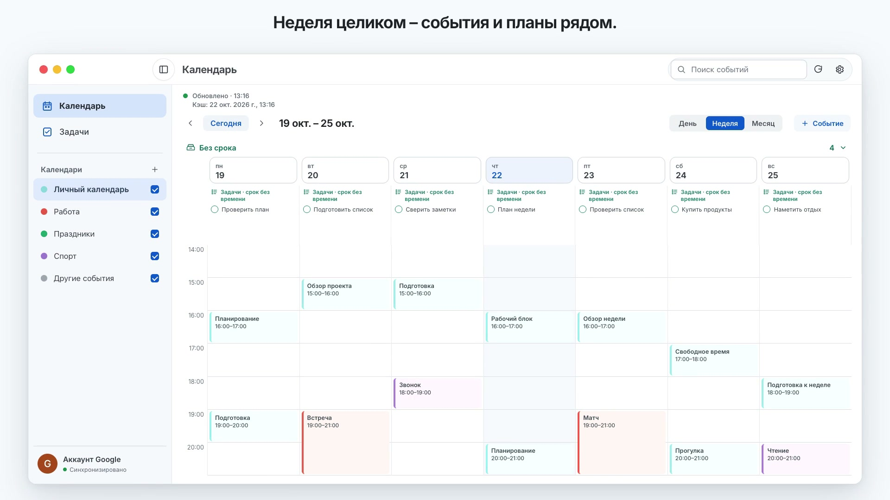

[Инструкция на русском](README.ru.md)

# g-calendar

A native macOS app for Google Calendar and Google Tasks, with a Pixel Paper interface, Color Atlas metadata, a local cache, and system reminders. Requires **macOS 13+ on Apple Silicon (arm64)**. Intel and universal builds are not available. Local acceptance was performed on macOS 27.0.1, rather than every supported OS version. No public binary release has been published yet.

## Demo

A short tour of the calendar and task views.

[](docs/demo.mp4)

[Open the demo video](docs/demo.mp4)

## Installation

From a downloaded checkout, with Git and Apple Command Line Tools installed (`xcode-select --install` if needed):

```sh
./scripts/install-source.sh
open "$HOME/Applications/g-calendar.app"
```

The default destination is `~/Applications`. Source updates retain the previous app for `--rollback`; uninstalling preserves settings, cache, local reminders, and Google credentials. Future GitHub Releases will include an ad-hoc preview DMG, ZIP, and signed update feed. The first launch of a downloaded app may require a macOS confirmation. See [installation details](docs/INSTALLATION.md) and the [release guide](docs/RELEASING.md).

## First launch

1. Open the app and choose **Войти через Google** (Sign in with Google; the current interface is in Russian).
2. Choose your Google account in the browser and grant Calendar and Tasks access. Your password is entered on Google's page; the refresh token is stored in macOS Keychain.
3. Choose automatic updates and launch at login, then click **Начать работу** (Start using the app). You can change both options in Settings later.
4. g-calendar loads your data through read-only requests. Google changes require explicit actions; deletion requires confirmation and writes are verified by reading the exact resource back.

You do not need an OAuth JSON file, a separate Google Cloud project, or `gws`. Google Workspace CLI is an optional connection method in Settings; users choosing it install and authorize it separately. Account availability depends on the application's Google OAuth project and consent-screen audience.

## Updates

Settings includes **Включить автообновление** (Enable automatic updates) and **Проверить обновления…** (Check for Updates). When enabled, the app checks GitHub Releases about once a day, downloads a compatible update, and installs it when the app quits. Sparkle also offers an install-and-relaunch dialog. Your account, cache, and settings are retained. Install the app into a writable folder such as `~/Applications`; it cannot update itself while running from a mounted DMG.

The update feed and archive are authenticated with EdDSA signatures before extraction. Turning off automatic updates stops scheduled checks and downloads; manual checks remain available. Until the first GitHub Release containing `appcast.xml` is published, there is no update to install, and a manual check may report that the feed is unavailable.

See [CHANGELOG.md](CHANGELOG.md) for changes and [docs/RELEASING.md](docs/RELEASING.md) for preparing a new version.

## Features

- Day, Week, and Month calendar views; task lists and boards with filters, search, due dates, and list tags.
- Light, Dark, and System appearance, native keyboard navigation, and accessible action controls.
- Explicit event, task, and task-list creation and editing; confirmation for destructive actions.
- A last-known-good local cache, complete pagination, sync status, and error handling.
- Google event popup reminders and device-local task/event reminders through UserNotifications. Notification permission is requested through an explicit action. Closing the last window leaves the app running.
- Optional automatic application updates and launch at login.

## Build and development

A Google account and `gws` are not needed to build or run fixture tests. The first build downloads pinned Sparkle 2.10.0 and verifies the archive's SHA-256.

```sh
./scripts/build-app.sh
open dist/g-calendar.app
./scripts/test.sh
env G_CALENDAR_TEST_OPTIMIZE=1 ./scripts/test.sh
./scripts/test-native-ui.sh
./scripts/test-installers.sh
```

Scripts invoke `swiftc` directly. The app is built at `dist/g-calendar.app`; temporary products are in `.build/`. There is no `Package.swift` or Xcode project, so `swift build` and `swift test` are not project commands. The historical SwiftPM preflight is documented in [docs/BUILD_PREFLIGHT.md](docs/BUILD_PREFLIGHT.md). Rebuild after an implementation session and relaunch the new bundle for manual review; a successful build does not verify its visual appearance.

To explore synthetic data, quit the normal app first and run:

```sh
open dist/g-calendar.app --args --demo
```

Demo mode does not invoke `gws`, read your cache, request notification permission, or start the application updater. Development guidance is in [CONTRIBUTING.md](CONTRIBUTING.md); product specifications and current status are in [docs/](docs/) and [OpenSpec](openspec/changes/g-calendar-mvp/).

## Support the author

Choose **Поддержать автора** (Support the author) at the bottom left of Settings. The support window offers a QR code, a browser action, and a copy-link action for each provider. Support is voluntary and does not restrict app features.

- [CloudTips](https://pay.cloudtips.ru/p/bf792932) — primary option.
- [Boosty](https://boosty.to/gcalendar/donate) — additional option.

## Data and security

- The default connection uses Google Calendar and Tasks APIs following browser sign-in. Long-lived credentials remain in Keychain. Optional `gws` is invoked with separate process arguments; configure only a trusted executable. The app does not export its credentials.
- Cache, local reminders, and the pending-write journal live in `~/Library/Application Support/g-calendar/`; preferences use UserDefaults. These JSON files can contain personal calendar/task data and saved drafts. Do not attach them, raw API responses, or personal screenshots to public reports.
- Updates, rollback, and uninstall preserve data and credentials. A pending-write journal is not an offline write queue; do not delete it to retry a write.
- Use demo fixtures and anonymized messages for bug reports. A private security contact and support policy are still open decisions: [docs/PENDING_DECISIONS.md](docs/PENDING_DECISIONS.md).

## Limitations

- Google Tasks `due` values are dates without times. Device-local reminder times do not sync back to Google.
- There is no durable offline write queue. Cached data stays readable after network errors.
- Recurring events are read-only. Attendees/invitations and local reminders for all-day/recurring events are not supported.
- Notification visibility depends on macOS permissions, Focus, and the Mac's state. Delivery during sleep or after quitting the app is not guaranteed. Visible banners and a complete VoiceOver pass require manual acceptance; dated evidence is in [docs/verification.md](docs/verification.md).
- GUI benchmarks measure response through an AppKit update, rather than pixel presentation or FPS; see [docs/GUI_PERFORMANCE.md](docs/GUI_PERFORMANCE.md).
- Ad-hoc signing and EdDSA update signatures do not provide Apple notarization. There is no project `LICENSE` yet; public distribution terms remain the owner's decision. Sparkle's license is included separately with the app.
