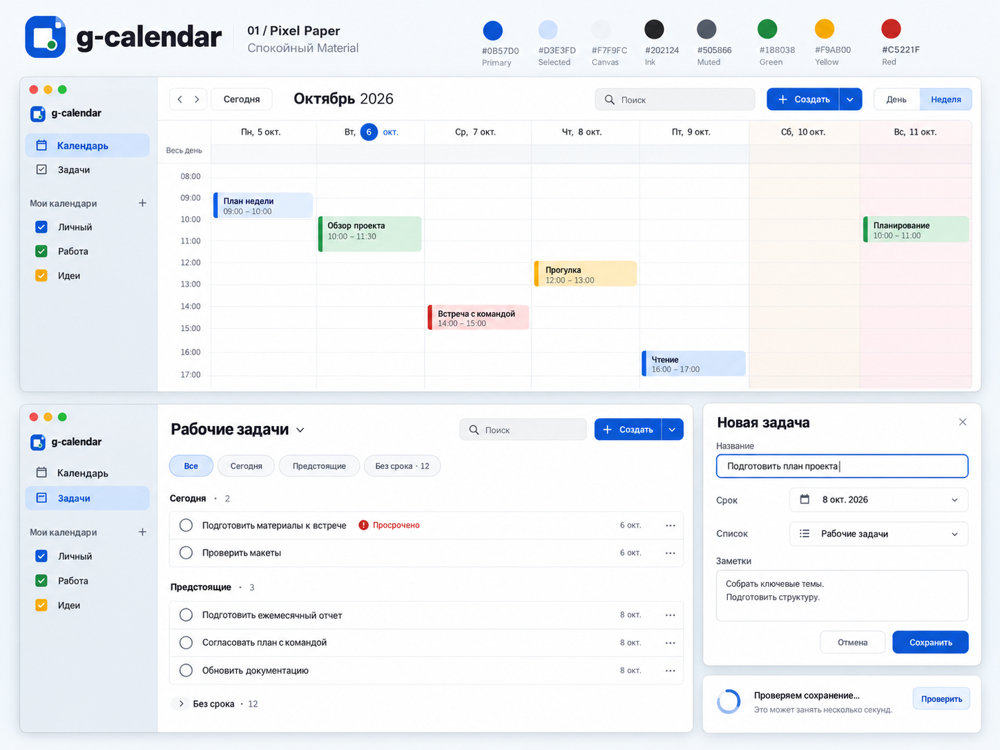
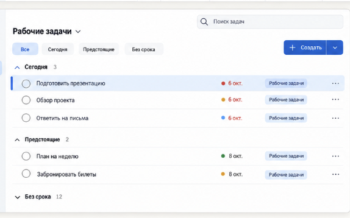

# Выбранный дизайн

Утверждено 2026-10-05: **Pixel Paper + компактный список задач Color Atlas**. Полный контракт — [DESIGN.md](DESIGN.md).

Отвергнутые варианты и промежуточные generation prompts удалены по просьбе владельца. Сохранены только утверждённая система и два нужных референса. Результаты реализации, проверок надёжности и финальной приёмки отступов сохранены в [журнале проверок](../docs/verification.md) и [OpenSpec tasks](../openspec/changes/g-calendar-mvp/tasks.md). Рабочие планы реализации хранятся локально.
